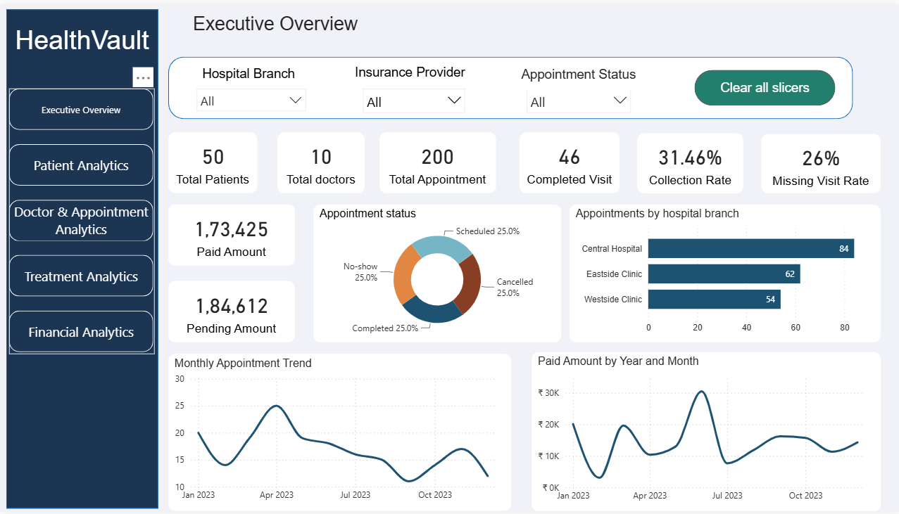
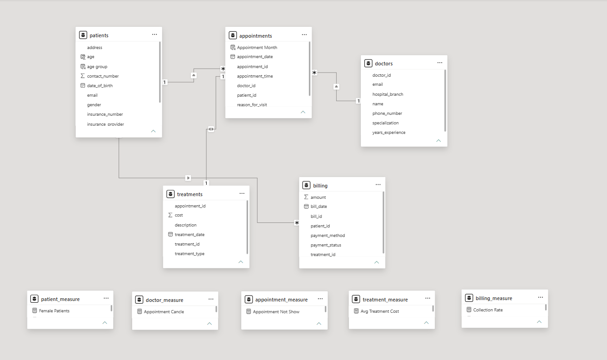
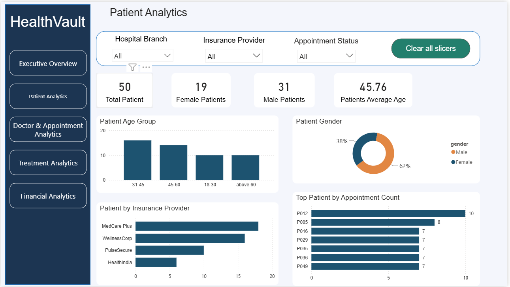
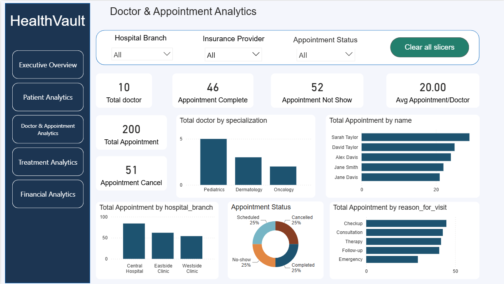
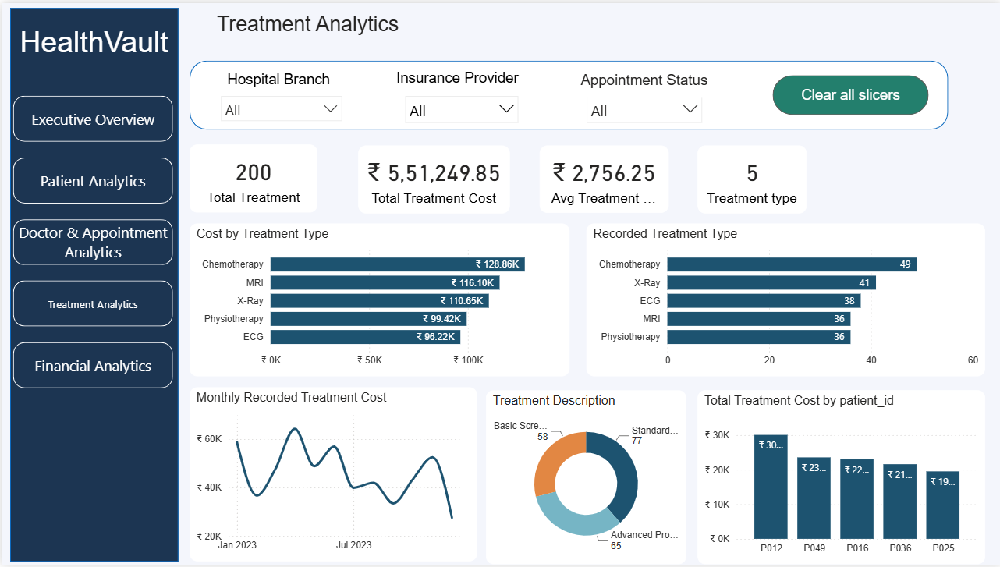
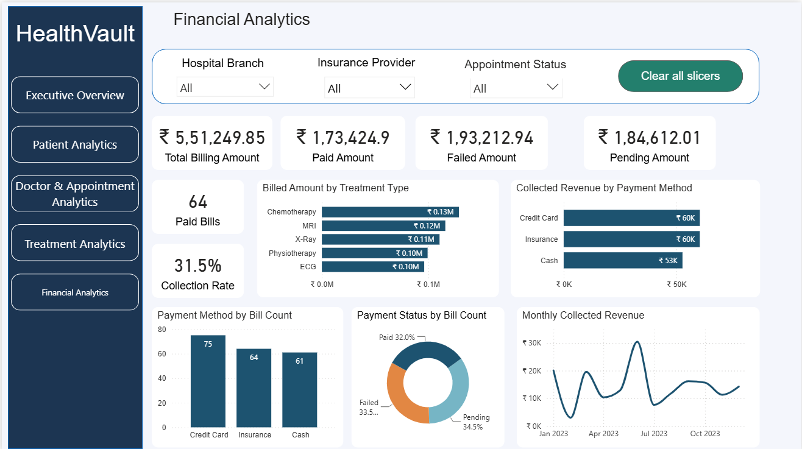

# HealthVault

## 1. Project Title & Objective

**Project:** HealthVault  
**Domain:** Healthcare Data Analytics  

The objective is to analyze patient demographics, doctor workloads, appointment outcomes, treatment records, and billing performance to help hospital managers identify scheduling inefficiencies, monitor payment collection, and make data-informed resource allocation decisions.

**Business problem:** How can a healthcare organization understand appointment cancellations and no-shows, distribute doctor workloads, monitor recorded treatment costs, and improve billing collections?

## 2. Dataset

**Source:** Healthcare Data Analysis (csv file)

| Dataset | Rows | Columns | Main information |
|---|---:|---:|---|
| `patients.csv` | 50 | 11 | Patient demographics, registration, insurance |
| `doctors.csv` | 10 | 8 | Specialization, experience, hospital branch |
| `appointments.csv` | 200 | 7 | Appointment date/time, doctor, patient, status |
| `treatments.csv` | 200 | 6 | Treatment type, date, description, cost |
| `billing.csv` | 200 | 7 | Bill amount, payment method, payment status |
| **Total across files** | **660** | **39** |  |

### Data model

Core joins:

- `Patients[patient_id]` **1 → many** `Appointments[patient_id]`
- `Doctors[doctor_id]` **1 → many** `Appointments[doctor_id]`
- `Appointments[appointment_id]` **1 → many** `Treatments[appointment_id]`
- `Treatments[treatment_id]` **1 → many** `Billing[treatment_id]`

## 3. Tools Used

| Tool | Use |
|---|---|
| **Power BI / DAX** | Proposed data model, Advance Calculations, KPI definitions and dashboard design |
| **CSV** | Input data format |

## 4. Key Business Questions & KPIs

### Patient analytics
- How many unique patients are registered?
- What is the patient distribution by gender, age group and insurance provider?
- How does patient registration change over time?

### Doctor & appointment analytics
- How many appointments were completed, cancelled, scheduled or marked no-show?
- Which doctors, specializations and branches handle the most appointments?
- What are the busiest appointment months and hours?
- What are the completion, cancellation and no-show rates?

### Treatment analytics
- Which treatment types appear most frequently?
- What are total and average recorded treatment costs?
- Which treatment categories account for the largest recorded costs?

### Financial analytics
- What is the total billed amount and collected revenue?
- How much is pending or marked failed?
- Which payment methods and doctor-associated branches account for collected revenue?
- How does revenue collection vary by month?

**KPI definitions:**

| KPI | Calculation |
|---|---|
| Appointment complete | Count of appointment where `status = Complete` |
| Appointment cancel | Count of appointment where `status = Cancel`|
| Appointment Not show | Count of appointment where `status = No-Show` |
| Paid amount | Sum of bill amounts where `payment_status = Paid` |
| Collection rate | Paid amount / Total billed amount |
| Pending amount | Sum of bill amounts where `payment_status = Pending` |

## 5. Visualizations / Dashboard

### Dashboard preview

The dashboard contains five pages:

1. **Executive Overview** — patients, doctors, appointments, completion, collections, pending amount, monthly trends.
2. **Patient Analytics** — gender, age, insurance and registration trends.
3. **Doctor & Appointment Analytics** — doctor workload, appointment status, specialization, visit reasons and busiest hours.
4. **Treatment Analytics** — treatment counts, categories and recorded costs.
5. **Financial Analytics** — billed, paid, pending and failed amounts, payment methods, monthly collections and doctor-associated branch revenue.

## 6. Results & Insights

| Metric | Result |
|---|---:|
| Registered patients | 50 |
| Doctors | 10 |
| Appointment records | 200 |
| Completed appointments | 46  |
| Cancelled appointments | 51  |
| Appointments Not show  | 52  |
| Collected revenue rate | 31.46 % |
| Missing visit rate | 26 % |
| Scheduled appointments | 51 |
| Recorded treatments | 200 |
| Female patient | 19  |
| Male patient | 39  |
| Patient average age | 45.76 |
| Total recorded treatment cost | ₹5,51,249.85 |
| Total billed amount | ₹5,51,249.85 |
| Paid bills | 64 |
| Collected revenue | ₹1,73,424.90 |
| Pending bills | 69 |
| Pending amount | ₹1,84,612.01 |
| Failed bills | 67 |
| Failed amount | ₹1,93,212.94 |
| Revenue collection rate | 31.46% |

### Key findings

1. **Appointment completion is low:** Only **23%** of the 200 appointment records are marked completed. The remaining statuses include scheduled appointments, so this is not a finalized-outcome rate for closed appointments.
2. **Cancellation and no-show volume is substantial:** **51 cancellations** and **52 no-shows** together account for **51.5%** of recorded appointments. Reviewing appointment reminders, lead times and scheduling processes could be valuable.
3. **Collections trail billing:** **₹1,73,424.90** is marked paid out of **₹5,51,249.85** billed, a **31.46%** collection rate in this dataset.
4. **Payment follow-up deserves attention:** **₹1,84,612.01** is pending. An additional **₹1,93,212.94** is marked failed; failed transactions should not automatically be treated as recoverable receivables.
5. **Data quality requires investigation:** Treatment and billing records are linked to appointments with statuses such as Scheduled, Cancelled and No-show. Consequently, recorded treatment counts and costs should not automatically be interpreted as verified completed care.
